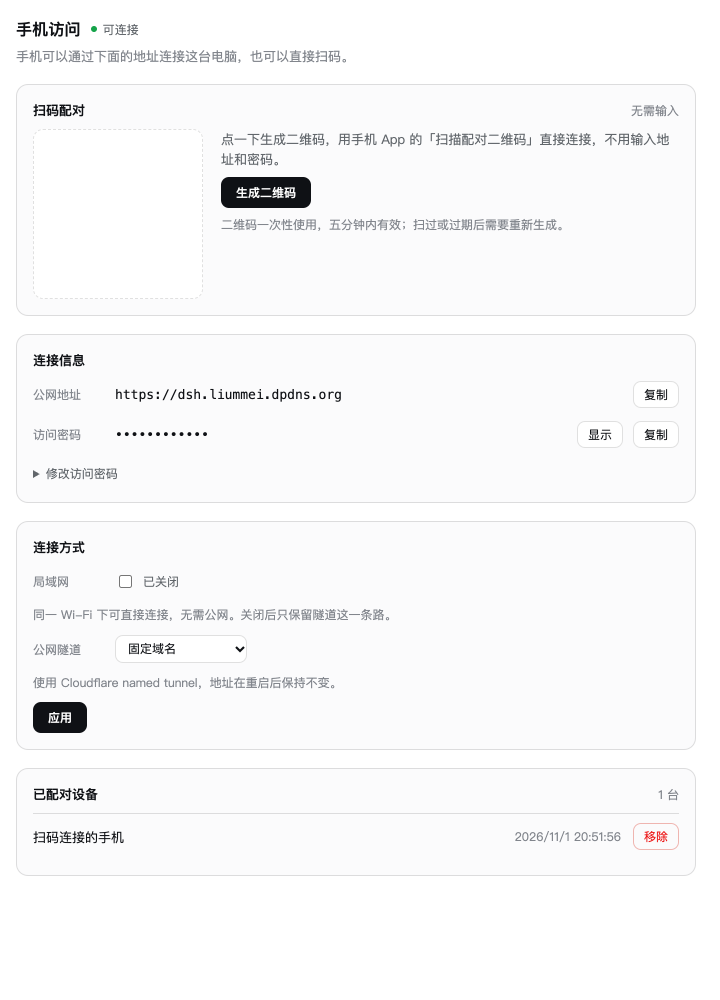
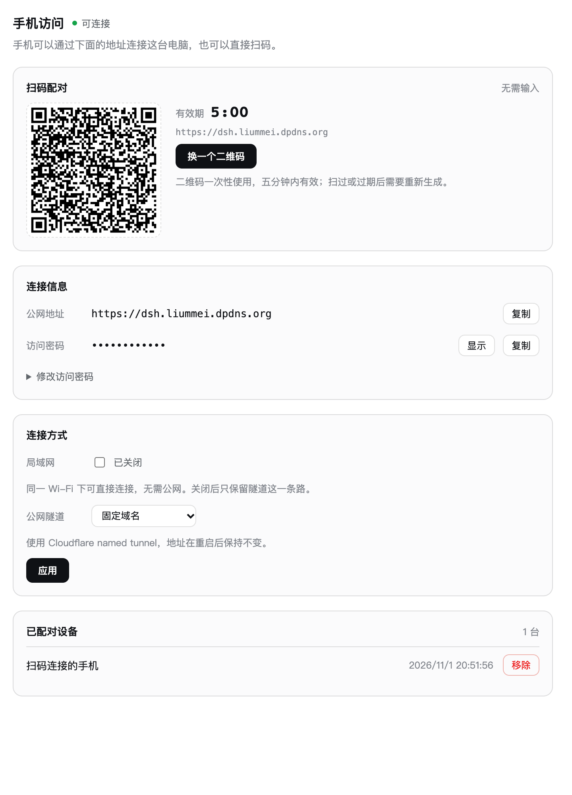
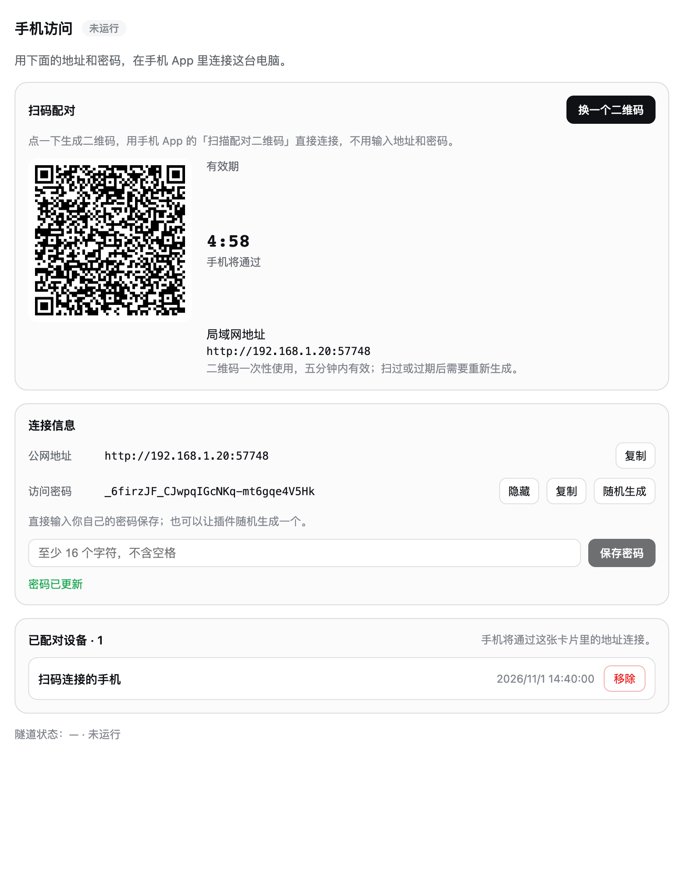
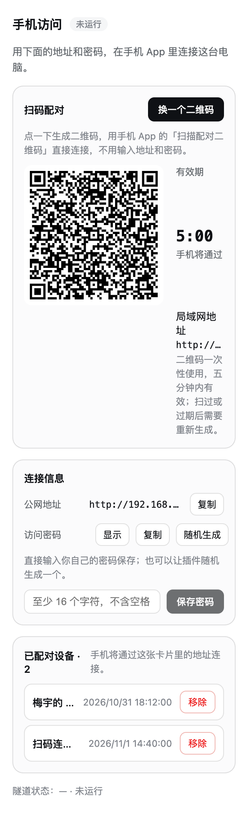

# 手机访问：界面与交互

设置 →「手机访问」这一节回答三个问题，按读者遇到的顺序排列：**怎么最快连上**（扫码）、**连不上时用什么**（地址与密码）、**现在有哪些手机连着**（已配对设备）。隧道状态是决定二维码里装哪个地址的那一个变量，所以它收成标题右侧的一枚状态胶囊，不占一整行。

## 布局

| 区域 | 内容 | 为什么在这里 |
| --- | --- | --- |
| 标题行 | `手机访问` + 隧道状态胶囊（已连接 / 连接中 / 未运行） | 状态决定二维码里的地址来源，先让读者知道"现在能不能扫" |
| 卡片一 · 扫码配对 | 生成/换一个按钮、二维码、倒计时、地址来源、有效期说明 | 唯一不用手打字的路径，放在第一位 |
| 卡片二 · 连接信息 | 公网/局域网地址 + 复制；密码显示/复制/随机生成；自定义密码输入 + 保存 | 扫码失败或没有相机时的退路，也是改密码的地方 |
| 卡片三 · 已配对设备 | 每台设备的名称、添加时间、移除按钮；标题带台数 | 事后管理，放在最后 |
| 页脚 | 隧道主机名 + 状态 | 排障时才有用，降到最后一行小字 |

每张卡片是 `0.5px` 描边 + `14px` 圆角 + `bg-layer-1` 的浅层底，卡片内标题 13/600，正文 12/18 tertiary，值用等宽字。所有颜色走 `--dsw-alias-*`，浅色/深色主题自动跟随。

## 交互

### 二维码

- 点「生成二维码」→ 桌面端签发一次性配对密钥（5 分钟有效），二维码里是手机端 `parsePairingPayload` 认识的那份 JSON。
- 生成后按钮变「换一个」；右侧 `mm:ss` 倒计时每秒刷新，归零后二维码整体替换为"已过期，请重新生成"。
- 地址来源优先公网（隧道），其次局域网；两者都没有时按钮点下去返回一条明确的中文原因，而不是画一个扫了也没用的码。
- 说明文字明确写了"一次性使用、五分钟内有效"，避免读者把它当长期凭证截图保存。

### 密码

两条路并存，不需要二选一：

1. **随机生成**：点「随机生成」，确认后换成 32 位 base64url 随机串（走原来的 rotate 接口）。
2. **自己写**：输入框里打字 → 「保存密码」。前端先做同样的规则校验（≥16 字符、无空格），服务端再校验一次；成功后就地显示绿色"密码已更新"，2 秒后淡出，并把密码切到可见状态，让读者确认自己写的值生效了。

失败反馈是行内的，不用 alert：太短、含空格、服务端拒绝，各显示各自的文案。输入框回车等同于点保存。

### 设备移除

之前"删不掉"的根因有两层：注册表的 `revoke` 只是给记录打一个 `revokedAt` 时间戳，`list()` 又原样返回全部记录，所以按了撤销之后那一行还在列表里。现在：

1. 新增 `MobileDeviceRegistry.remove()`，把记录整个删掉；`PersistentDeviceRegistry` 覆写它并立即落盘。
2. 删除接口先 `revoke` 再 `remove` —— 先让那台手机的 bearer token 失效，再从列表里消失。只删记录不撤销，会留下一台"列表里没有但还能连"的设备。
3. `status` 只返回未撤销的设备，双保险。

每行右侧是红色描边的「移除」，点了先确认（说明移除后要重新扫码或重新登录），确认后该行消失、标题台数同步减一。

## 窄栏

右栏面板只有 ~320px，所以 `panel.js` 用同一套卡片、更小的二维码（120px）、把设备行压成单行。在 320px 下实测无横向溢出。

## 实测尺寸

760px 视口、deviceScaleFactor 2：

| 元素 | 尺寸 | 字号/字重 |
| --- | --- | --- |
| 卡片 | 720 宽，内边距 14 | — |
| 标题 | 22 高 | 16 / 600 |
| 状态胶囊 | 18 高，圆角 999 | 11 / 500 |
| 卡片标题 | 18 高 | 13 / 600 |
| 主按钮 | 31 高 | 12 / 500 |
| 二维码容器 | 180×180（内 168 白底） | — |
| 输入框 | 31 高 | 13 / 400 |
| 设备行 | 47 高 | 13 / 500 + 12 tertiary |
| 移除按钮 | 29 高 | 12 / 400，`state-error-primary` |

## 怎么复现这些图

`docs/ui/` 里的截图来自一个最小渲染夹具：把 `MobileBridgeSection` 挂进一个 React 根，`rpcCall` 用内存数据模拟五个端点（status / createPairing / setPassword / rotatePassword / deleteDevice），不需要启动整个桌面端。夹具代码不随包发布，只用于审查这一节的布局与交互状态。
